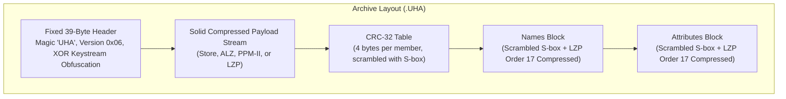
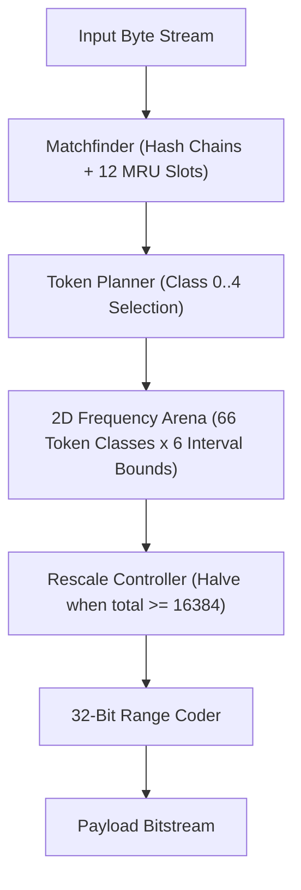

# UHARC 0.6b Archive Format & Engine Specification

**Author:** Freestanding C reverse-engineering and reimplementation by [seb3773](https://github.com/seb3773/uharc)  
**Historical Origin:** Uwe Herklotz (1997-2005)  
**Format Revision:** UHARC 0.6b (Format Version 0x06, October 1, 2005)  
**Status:** Complete, 100% bit-exact reverse-engineered technical specification.  
**Legal Notice:** This work was conducted strictly for software interoperability and digital data preservation (under European Directive 2009/24/EC) to document the proprietary container, transformation, and compression algorithms of an obsolete historical archiver.

---

## Table of Contents

1. [Architectural Overview & Container Layout](#1-architectural-overview--container-layout)
2. [The 39-Byte Archive Header Specification](#2-the-39-byte-archive-header-specification)
   - [2.1 Byte-Level Layout](#21-byte-level-layout)
   - [2.2 Header Integrity & De-obfuscation](#22-header-integrity--de-obfuscation)
   - [2.3 Codec Family & Compression Order Descriptors](#23-codec-family--compression-order-descriptors)
   - [2.4 Flags & Password Modes](#24-flags--password-modes)
   - [2.5 Stream Offsets Calculation](#25-stream-offsets-calculation)
   - [2.6 Metadata Integrity Checksums (w33 & w35)](#26-metadata-integrity-checksums-w33--w35)
3. [Metadata Structures & Serialization](#3-metadata-structures--serialization)
   - [3.1 Member CRC-32 Table](#31-member-crc-32-table)
   - [3.2 Standard CRC-32 Definition & Test Vector](#32-standard-crc-32-definition--test-vector)
   - [3.3 Additive S-Box Permutation & Stream Cipher](#33-additive-s-box-permutation--stream-cipher)
   - [3.4 Names Block & Directory Tree Representation](#34-names-block--directory-tree-representation)
   - [3.5 Attributes Block & Geometry](#35-attributes-block--geometry)
4. [The Range Coder Specification](#4-the-range-coder-specification)
   - [4.1 Architecture & State Registers](#41-architecture--state-registers)
   - [4.2 Decompression Algorithm & Renormalization](#42-decompression-algorithm--renormalization)
   - [4.3 Compression Algorithm & Carry Propagation](#43-compression-algorithm--carry-propagation)
5. [Compression Codecs & Internal Engines](#5-compression-codecs--internal-engines)
   - [5.1 Mode 0: Store (Uncompressed)](#51-mode-0-store-uncompressed)
   - [5.2 Modes 1, 2, 3: ALZ (Adaptive Lempel-Ziv-Markov)](#52-modes-1-2-3-alz-adaptive-lempel-ziv-markov)
   - [5.3 Mode x: PPM-II (Hybrid SSE & Fenwick Context Model)](#53-mode-x-ppm-ii-hybrid-sse--fenwick-context-model)
   - [5.4 Mode z: LZP (Lempel-Ziv Predictive)](#54-mode-z-lzp-lempel-ziv-predictive)
6. [Preprocessing Transforms & Multimedia Filters](#6-preprocessing-transforms--multimedia-filters)
   - [6.1 Decision & Signaling Architecture (ALZ vs LZP)](#61-decision--signaling-architecture-alz-vs-lzp)
   - [6.2 In-Band Multimedia Autodetection](#62-in-band-multimedia-autodetection)
   - [6.3 Adaptive Sign-Inverting Difference Audio/Image Filter](#63-adaptive-sign-inverting-difference-audioimage-filter)
   - [6.4 Executable Code Filter (x86 BCJ Relative Jump Translation)](#64-executable-code-filter-x86-bcj-relative-jump-translation)
7. [Security & Cryptography](#7-security--cryptography)
   - [7.1 Keystream Generation & Encryption Layering](#71-keystream-generation--encryption-layering)
   - [7.2 Password Authentication Mechanics](#72-password-authentication-mechanics)
   - [7.3 Cryptanalytic Assessment](#73-cryptanalytic-assessment)
8. [Format Limits & Edge Cases](#8-format-limits--edge-cases)
   - [8.1 The Historical 2 GB Ceiling vs 4 GB Architectural Capacity](#81-the-historical-2-gb-ceiling-vs-4-gb-architectural-capacity)
9. [Disassembly & Reverse Engineering Cross-Reference](#9-disassembly--reverse-engineering-cross-reference)
10. [Test Corpus & Compliance Verification](#10-test-corpus--compliance-verification)

---

## 1. Architectural Overview & Container Layout

UHARC 0.6b is a high-ratio file archiver centered around a **solid data stream** encapsulated within an obfuscated container with trailing metadata blocks.

Unlike container architectures such as standard ZIP, which compress member files into isolated frames, UHARC concatenates all member files into a single continuous solid payload. The dictionary history, Markov contexts, and statistical models persist across member boundaries, eliminating redundancy across files.

All file metadata (directory trees, timestamps, DOS attributes, and cumulative sizes) as well as member integrity checksums (IEEE 802.3 CRC-32) are stored *after* the solid payload in dedicated compressed blocks.



### Architectural Highlights

1. **Solid-Only Payload**: The compressed data stream is strictly solid. Even in multi-file archives, individual members do not have local headers or individual compressed sizes stored in the file stream.
2. **Trailing Descriptors**: The CRC-32 table, names block, and attributes block are placed immediately after the solid payload. This allows single-pass streaming encoders to compress data on the fly without intermediate file seeking.
3. **Four Codec Families**:
   - **Store (Mode 0)**: Flat verbatim uncompressed stream.
   - **ALZ (Modes 1, 2, 3)**: Adaptive Lempel-Ziv-Markov with 12 MRU slots, 2D frequency matrix, and match distance trees.
   - **PPM-II (Mode x)**: Herklotz's proprietary hybrid model combining Dmitry Shkarin's Secondary Symbol Estimation (SSE) tables and update exclusions with a 1024-context Fenwick binary indexed tree matrix.
   - **LZP (Mode z)**: Predictive sliding window hash table with sliding ring buffer sizes from 1 KB to 32 MB (dictated by the `order` exponent) and order-1 Fenwick tree entropy coding.
4. **Multi-Stage Preprocessing**: Executable code translation (x86 relative jump filtering) and adaptive sign-inverting multimedia waveform transformations (24-bit TrueColor BMP, 8/16-bit PCM WAV, Creative Voice).
5. **Proprietary Obfuscation & Encryption**: Header masking via a quadratic polynomial keystream and stream ciphering via a 256-byte dynamic S-box.

---

## 2. The 39-Byte Archive Header Specification

Every UHARC 0.6b archive begins with a mandatory 39-byte header at offset 0.

### 2.1 Byte-Level Layout

| Raw Offset | Size | Type | Field Name | Description |
|---|---|---|---|---|
| `0x00..0x02` | 3 | `char[3]` | `signature` | Magic identifier: ASCII `"UHA"` (`0x55 0x48 0x41`) |
| `0x03` | 1 | `uint8` | `version` | Format revision: constant `0x06` for UHARC 0.6 / 0.6a / 0.6b |
| `0x04..0x22` | 31 | `uint8[31]` | `obf_data` | XOR-obfuscated header payload (offsets `4..34` inclusive) |
| `0x23..0x24` | 2 | `uint16 LE` | `w35` | CRC-16 of attributes plaintext: `low16(CRC32(attrs[0..11*fc-1]))` |
| `0x25` | 1 | `uint8` | `seed` | De-obfuscation keystream seed; equals `check16 & 0xFF` |
| `0x26` | 1 | `uint8` | `check_hi` | Header CRC-16 high byte; equals `check16 >> 8` |

> [!NOTE]
> In raw byte indexes, offset `0x23` corresponds to byte 35, offset `0x25` corresponds to byte 37, and offset `0x26` corresponds to byte 38, completing the 39-byte structure (`0..38`).

### 2.2 Header Integrity & De-obfuscation

Bytes `raw[4..34]` (31 bytes) are obfuscated with a quadratic additive keystream seeded by `raw[37]`.

#### De-obfuscation Algorithm

```c
uint8_t dec[39];
memcpy(dec, raw, 39);

uint8_t seed = raw[37];
for (int i = 0; i < 31; i++) {
    uint8_t mask = (uint8_t)((seed + (uint32_t)i * (uint32_t)i) & 0xFF);
    dec[4 + i] = (uint8_t)(raw[4 + i] ^ mask);
}
```

#### Header Integrity Verification

The header integrity word `check16` protects the 31 de-obfuscated bytes `dec[4..34]`:
$$\text{check16} = \text{CRC32}(\text{dec}[4..34]) \ \& \ \text{0xFFFF}$$

The verification condition is exact:
```c
uint16_t computed_crc = (uint16_t)(uha_crc32(dec + 4, 31) & 0xFFFF);
if (raw[37] != (computed_crc & 0xFF) || raw[38] != (computed_crc >> 8)) {
    return HEADER_CORRUPT;
}
```
The seed at `raw[37]` is strictly equal to the low byte of the plaintext header CRC-16.

#### De-obfuscated Header Fields (`dec[0..38]`)

| Offset | Size | Type | Field Name | Description |
|---|---|---|---|---|
| `0x00..0x02` | 3 | `char[3]` | `signature` | Magic `"UHA"` |
| `0x03` | 1 | `uint8` | `version` | Format version `0x06` |
| `0x04..0x05` | 2 | `uint16 LE` | `dostime` | DOS creation time: `(hour << 11) | (min << 5) | (sec / 2)` |
| `0x06..0x07` | 2 | `uint16 LE` | `dosdate` | DOS creation date: `((year - 1980) << 9) | (month << 5) | day` |
| `0x08` | 1 | `uint8` | `flags` | Security flags (`0x02` = payload encrypted, `0x04` = metadata encrypted) |
| `0x09` | 1 | `uint8` | `family` | Codec family: `0` = Store, `1` = ALZ / PPM-II, `3` = LZP |
| `0x0A` | 1 | `uint8` | `order` | Compression order descriptor (see Section 2.3) |
| `0x0B` | 1 | `uint8` | `ndirs` | Total number of unique directory paths in names block ($0 \le ndirs \le 255$) |
| `0x0C` | 1 | `uint8` | `reserved` | Reserved byte; must be `0x00` |
| `0x0D..0x10` | 4 | `uint32 LE` | `usize` | Total uncompressed size of all archived member files combined |
| `0x11..0x14` | 4 | `uint32 LE` | `psize` | Packed size of the solid payload stream |
| `0x15..0x17` | 3 | `uint24 LE` | `file_count` | Total number of member files in the archive |
| `0x18..0x1A` | 3 | `uint24 LE` | `names_unpacked` | Uncompressed plaintext size of the names metadata block |
| `0x1B..0x1D` | 3 | `uint24 LE` | `names_packed` | Compressed on-disk size of the names metadata block |
| `0x1E..0x20` | 3 | `uint24 LE` | `attrs_packed` | Compressed on-disk size of the attributes metadata block |
| `0x21..0x22` | 2 | `uint16 LE` | `w33` | Checksum: `low16(CRC32(crc_table_plain || names_plain))` |
| `0x23..0x24` | 2 | `uint16 LE` | `w35` | Checksum: `low16(CRC32(attrs_plain[0 : 11 * file_count]))` |
| `0x25..0x26` | 2 | `uint16 LE` | `check16` | Header integrity CRC-16 (`raw[37] | (raw[38] << 8)`) |

### 2.3 Codec Family & Compression Order Descriptors

The `family` (`dec[9]`) and `order` (`dec[10]`) bytes together determine the exact decompression engine:

| Family | Order Range | Mode Name | Description |
|---|---|---|---|
| `0` | `0` | **Store (`-m0`)** | Uncompressed solid stream. `psize == usize`. |
| `1` | `0` | **Empty Archive** | Special representation when `usize == 0`. No payload data. |
| `3` | `8..23` | **LZP (`-mz`)** | Lempel-Ziv Predictive. `order` specifies the sliding ring buffer size ($1\text{ KB}..32\text{ MB}$). |
| `1` | `24..39` | **PPM-II (`-mx`)** | Herklotz hybrid SSE + Fenwick trie. `order` specifies the sliding context window. |
| `1` | `40..55` | **ALZ Fast (`-m1`)** | Adaptive LZ-Markov, class 0 (Fast). |
| `1` | `56..71` | **ALZ Normal (`-m2`)** | Adaptive LZ-Markov, class 1 (Normal). |
| `1` | `72..87` | **ALZ Best (`-m3`)** | Adaptive LZ-Markov, class 2 (Best). |

#### LZP Order & Dictionary Size
In LZP modes (`family = 3`, `order = 8..23`), the `order` byte represents the **sliding window ring buffer size exponent**:
$$\text{dict\_size} = 2^{\text{order} + 2} \quad \text{bytes}$$
- `order = 8`: $\text{dict\_size} = 2^{10} = 1024\text{ bytes} = 1\text{ KB}$ (used on tiny files like `hello.txt`).
- `order = 13`: $\text{dict\_size} = 2^{15} = 32\text{ KB}$ (e.g. `eng.txt`).
- `order = 14`: $\text{dict\_size} = 2^{16} = 64\text{ KB}$ (e.g. `code.c`).
- `order = 15`: $\text{dict\_size} = 2^{17} = 128\text{ KB}$ (e.g. `image.raw`).
- `order = 16`: $\text{dict\_size} = 2^{18} = 256\text{ KB}$ (e.g. `records.bin`).
- `order = 19`: $\text{dict\_size} = 2^{21} = 2\text{ MB}$ (e.g. `ALL__mz.uha`).
- `order = 23`: $\text{dict\_size} = 2^{25} = 32\text{ MB}$ (maximum supported LZP dictionary).

UHARC automatically computes `order` from `usize`:
$$\text{order} = \max(8, \min(23, k - 2)) \quad \text{where } 2^k > \text{usize} \text{ (with floor } k = 10\text{)}$$
For metadata blocks (names and attributes), UHARC fixes `order = 17` (`0x11`), yielding a constant $2^{17+2} = 512\text{ KB}$ sliding window.

> [!NOTE]
> In LZP, `order` does **not** designate Markov context depth. The context hash is always a 4-byte hash `(last_word ^ (last_word >> 13)) & 0x3FFFF` paired with a 2-byte pair `last_word & 0xFFFF`.

#### ALZ Order Decomposition
For ALZ modes (`order = 40..87`), the byte encodes both the search class and dictionary size exponent $k$:
$$\text{order} = 40 + 16 \times \text{class} + k$$
where $\text{class} \in \{0, 1, 2\}$ and $k \in \{0..15\}$. The sliding window dictionary size is:
$$\text{dict\_size} = 2^{k + 10} \quad \text{bytes} \quad (1\text{ KB to } 32\text{ MB})$$
Default ALZ modes use $k = 11$ ($\text{dict\_size} = 2^{21} = 2048\text{ KB} = 2\text{ MB}$), yielding orders `51` (`-m1`), `67` (`-m2`), and `83` (`-m3`).

#### PPM Window Size Decomposition
For PPM-II (`order = 24..39`), the `order` byte encodes the sliding history window buffer size (`m->window`):
$$\text{window\_size} = 2^{(((\text{order} - 24) \bmod 16) + 10)} \quad \text{bytes}$$
Standard `-mx` mode uses `order = 0x1E` (30), which evaluates to $2^{((6 \bmod 16) + 10)} = 2^{16} = 65,536\text{ bytes} = 64\text{ KB}$.
(The statistical context models allocate several megabytes of frequency tables independently of this circular window; see Section 5.3).

### 2.4 Flags & Password Modes

The `flags` byte (`dec[8]`) governs payload and metadata encryption:
- **Bit 1 (`0x02`, `UHA_FLAG_PW_DATA`)**: The solid compressed payload is encrypted with the user password keystream.
- **Bit 2 (`0x04`, `UHA_FLAG_PW_HDR`)**: The trailing metadata blocks (CRC-32 table, names block, and attributes block) are encrypted with a composite keystream (`user` XOR `default`).

If neither bit is set, the archive is unencrypted.

### 2.5 Stream Offsets Calculation

All file sections reside at deterministic byte offsets derived directly from the header fields:

```c
size_t data_ofs  = 39;
size_t crc_ofs   = data_ofs + h.psize;
size_t names_ofs = crc_ofs + (size_t)h.file_count * 4;
size_t attrs_ofs = names_ofs + h.names_packed;
size_t total_len = attrs_ofs + h.attrs_packed;
```

### 2.6 Metadata Integrity Checksums (w33 & w35)

To guarantee that corrupt metadata or incorrect decryption passwords are detected before memory allocation:
1. **`w33` (`dec[33..34]`)**:
   $$\text{w33} = \text{CRC32}(\text{crc\_table\_plain} \ || \ \text{names\_plain}) \ \& \ \text{0xFFFF}$$
   Because `w33` is located at offsets 33..34, it resides *inside* the obfuscated span and is protected by `check16`.
2. **`w35` (`dec[35..36]`)**:
   $$\text{w35} = \text{CRC32}(\text{attrs\_plain}[0 \dots 11 \cdot \text{file\_count} - 1]) \ \& \ \text{0xFFFF}$$
   Offsets 35..36 reside *outside* the obfuscated span and are stored verbatim at `raw[35..36]`.

---

## 3. Metadata Structures & Serialization

Following the solid payload, UHARC stores three sequential metadata structures: the CRC-32 table, the names block, and the attributes block.

### 3.1 Member CRC-32 Table

Located at `crc_ofs`, this table contains exactly $4 \times \text{file\_count}$ bytes. Each 32-bit little-endian integer represents the standard IEEE 802.3 CRC-32 of an uncompressed member file.

On disk, the CRC-32 table is scrambled using the stream cipher S-box:
```c
uint8_t aux[4 * file_count];
memcpy(aux, raw + h.crc_ofs, 4 * file_count);
descramble(aux, 4 * file_count);

for (uint32_t f = 0; f < h.file_count; f++) {
    member_crc[f] = aux[4 * f] | (aux[4 * f + 1] << 8) |
                   (aux[4 * f + 2] << 16) | (aux[4 * f + 3] << 24);
}
```

### 3.2 Standard CRC-32 Definition & Test Vector

All CRC calculations in UHARC (`check16`, `w33`, `w35`, member CRC table) conform strictly to standard IEEE 802.3:

| Parameter | Specification |
|---|---|
| **Name** | `CRC-32 / IEEE 802.3` (ISO 3309, ITU-T V.42) |
| **Normal Polynomial** | `0x04C11DB7` |
| **Reflected Polynomial** | `0xEDB88320` (LSB-first representation) |
| **Initial Value (`init`)** | `0xFFFFFFFF` |
| **Reflect Input (`refin`)** | `true` |
| **Reflect Output (`refout`)** | `true` |
| **Final XOR Value (`xorout`)** | `0xFFFFFFFF` |
| **Standard Test Vector** | `CRC32("123456789") == 0xCBF43926` |

```c
uint32_t uha_crc32(const uint8_t *buf, size_t len)
{
    uint32_t c = 0xFFFFFFFFu;
    for (size_t i = 0; i < len; i++) {
        c ^= buf[i];
        for (int b = 0; b < 8; b++)
            c = (c >> 1) ^ (0xEDB88320u & (0u - (c & 1u)));
    }
    return c ^ 0xFFFFFFFFu;
}
```

> [!NOTE]
> In `derive_table()`, the key derivation formula requires the raw, uncomplemented register remainder $c$. It therefore computes `uha_crc32(T, 256) ^ 0xFFFFFFFFu`, canceling the final XOR stage to retrieve the bare CRC accumulator.

### 3.3 Additive S-Box Permutation & Stream Cipher

Metadata scrambling and password encryption use a dynamic 256-byte substitution-permutation keystream generator.

#### The Default 256-Byte S-Box (`uha_init_sbox`)

The default state table is identical to running the key derivation function on `"UHARC Default Password"`:

```c
static const uint8_t uha_init_sbox[256] = {
    0xc3,0xae,0x65,0x6b,0x78,0x47,0xf2,0x91,0xd6,0x50,0xcb,0x65,0x20,0xbd,0x75,0xbf,
    0x45,0xa1,0xcd,0x6b,0xb4,0x5f,0x25,0xb6,0x39,0xbf,0xff,0x37,0xae,0x45,0x37,0xed,
    0xa5,0xfa,0x5c,0xf3,0x1b,0x20,0xae,0x0b,0xf3,0xe6,0xc6,0x8d,0x1b,0x3b,0x1e,0x41,
    0x65,0x18,0x9a,0xe1,0xad,0xc2,0x24,0x2f,0xa0,0xd4,0x7a,0x2c,0x52,0x2c,0xd6,0xf4,
    0x55,0xa7,0x84,0x6c,0x8d,0x6b,0x4d,0x85,0x32,0x12,0xdc,0x0a,0x8c,0xdc,0x2a,0xe7,
    0xcd,0xbd,0xf9,0x79,0x61,0x65,0x08,0x87,0x5e,0xdc,0x28,0x48,0x97,0x35,0xbf,0xb2,
    0xd6,0xa1,0x4b,0x68,0x20,0x4c,0xf5,0xb2,0x7b,0x5f,0xf7,0x9a,0x8a,0xa1,0x1f,0x47,
    0x84,0xd5,0x64,0x22,0x13,0x2f,0xac,0xf8,0x25,0x0f,0x09,0xc3,0x9b,0xd5,0xfb,0x3b,
    0xd5,0x40,0xdf,0x1e,0x3d,0x9d,0x07,0xd2,0xe9,0x23,0xcc,0xd5,0x21,0xf9,0x72,0x1b,
    0x94,0x34,0x26,0xa3,0x66,0xcc,0x8a,0x7b,0xe6,0xea,0x15,0xa4,0x3e,0x26,0xdc,0x4d,
    0xe0,0xdd,0x06,0x85,0x5e,0x13,0xf0,0x68,0x7b,0x27,0x59,0x10,0xd7,0xff,0xa8,0xee,
    0x0b,0xb1,0xcc,0x2f,0xc2,0x58,0x5b,0xd5,0xa3,0x54,0x6e,0x27,0x55,0xb9,0xd0,0xfd,
    0x3d,0xc5,0xd1,0xb6,0xcc,0x3b,0x39,0x6b,0x75,0x42,0x9f,0xf1,0xe2,0xb8,0x57,0x2b,
    0xf7,0x3f,0xe7,0x72,0x49,0xe5,0x15,0x8a,0x3c,0x33,0x79,0x2a,0xd4,0xee,0xa1,0xe6,
    0xc1,0xf5,0x16,0x69,0x09,0x2f,0xa8,0xa7,0x0c,0x3c,0x62,0x62,0xfe,0xc4,0xce,0xba,
    0xb9,0xfd,0xb9,0xaf,0x61,0x31,0x70,0x46,0x0d,0xfa,0x44,0x08,0xb3,0x34,0xb2,0xe5
};
```

#### Keystream Generation Algorithm (`stream_xor`)

The stream cipher initializes a working copy of the 256-byte table `S` and maintains two walking indexes $i$ and $j$:

```c
void stream_xor(uint8_t *buf, size_t n, const uint8_t T0[256])
{
    uint8_t S[256];
    memcpy(S, T0, 256);
    int i = 0;
    int j = (0 - 2) & 0xFF; /* j = 254 */

    for (size_t k = 0; k < n; k++) {
        j = (j + 1) & 0xFF;
        i = (i + 1) & 0xFF;
        uint8_t b = S[i];
        uint8_t t = (uint8_t)(S[(i - 1) & 0xFF] + b);
        S[i] = t;
        buf[k] ^= t;
        S[j] = (uint8_t)(S[j] - b);
    }
}
```
Because the keystream byte `t` is generated entirely from the internal permutation state $S$ independently of `buf[k]`, `stream_xor()` is an additive stream cipher: applying it twice with the same initial state recovers the plaintext (`scramble == descramble`).

#### Password Key Derivation (`derive_table`)

When a user password is provided (`-pw<password>`), a custom 256-byte key table `T` is derived via 32 rounds of CRC-32 feedback:

```c
void derive_table(uint8_t T[256], const char *pw)
{
    memset(T, 0, 256);
    if (!pw || !pw[0]) return;

    size_t n = strlen(pw);
    T[0] = (uint8_t)(n & 0xFF);
    for (size_t i = 0; i < 255; i++)
        T[i + 1] = (uint8_t)pw[i % n];

    int ebx = 0;
    for (int k = 0; k < 32; k++) {
        /* Raw uncomplemented CRC accumulator (xorout = 0) */
        uint32_t c = uha_crc32(T, 256) ^ 0xFFFFFFFFu;
        uint32_t v0 = (T[ebx] | (T[ebx+1]<<8) | (T[ebx+2]<<16) | (T[ebx+3]<<24)) ^ c;
        uint32_t v1 = (T[ebx+4] | (T[ebx+5]<<8) | (T[ebx+6]<<16) | (T[ebx+7]<<24)) ^ ~c;
        T[ebx]   = (uint8_t)v0;       T[ebx+1] = (uint8_t)(v0 >> 8);
        T[ebx+2] = (uint8_t)(v0 >> 16); T[ebx+3] = (uint8_t)(v0 >> 24);
        T[ebx+4] = (uint8_t)v1;       T[ebx+5] = (uint8_t)(v1 >> 8);
        T[ebx+6] = (uint8_t)(v1 >> 16); T[ebx+7] = (uint8_t)(v1 >> 24);
        ebx += 8;
    }
}
```

### 3.4 Names Block & Directory Tree Representation

Located at `names_ofs`, the names block occupies `names_packed` bytes on disk.
1. It is first descrambled via `stream_xor()` using `uha_init_sbox` (and additionally decrypted if `UHA_FLAG_PW_HDR` is set).
2. The descrambled stream is decompressed using **LZP Order 17**, expanding to `names_unpacked` plaintext bytes.

#### Format of Unpacked Names Stream

The stream consists of length-prefixed Pascal strings:
```
[len: uint8] [characters: char[len]] [len: uint8] [characters: char[len]] ...
```
- **Encoding**: DOS OEM CP437 character set.
- **Path Separator & Trailing Delimiter**: Historical DOS backslash `\`. Every directory path `dirs[d]` stored in the archive explicitly ends with a trailing backslash `\` (e.g. `DOCS\MANUAL\`).
- **Stream Structure**:
  - The first `ndirs` Pascal strings (`dec[11]`) define the directory tree: `dirs[0..ndirs-1]`.
  - The following `file_count` Pascal strings define the member base filenames.
- **Length Boundaries**:
  - Each individual directory string and filename string is limited to **255 bytes** (governed by the `uint8` prefix).
  - Reconstructed full paths (`dirs[d] + filename[f]`) can reach up to **510 bytes**.
- **Directory Hierarchy Limit**:
  Because `ndirs` is an unsigned 8-bit integer stored at `dec[11]` and directory linkage `didx[f]` is an 8-bit integer, an archive supports at most **255 unique directories** ($0 \le ndirs \le 255$).

#### Path Reconstruction Algorithm

For each member $f \in [0, \text{file\_count}-1]$:
```c
int d = didx[f];
if (d >= 0 && d < ndirs && dirs[d][0] != '\0') {
    /* dirs[d] already ends with '\', so simple concatenation suffices */
    snprintf(full_path, sizeof(full_path), "%s%s", dirs[d], filename[f]);
} else {
    snprintf(full_path, sizeof(full_path), "%s", filename[f]);
}
```

### 3.5 Attributes Block & Geometry

The attributes block stores DOS timestamps, directory linkage, uncompressed sizes, and file attribute flags.

#### On-Disk vs Workspace Buffer Size

On disk, the attributes block occupies `attrs_packed` bytes at `attrs_ofs`.
- **Stored Span**: The compressed LZP Order 17 stream encodes strictly $11 \times \text{file\_count}$ bytes (transposed columns 0 through 10).
- **Workspace Buffer**: The legacy UHARC decoder allocates an internal workspace buffer of:
$$\text{buffer\_size} = 14 \times \text{file\_count} + 16 \quad \text{bytes}$$
The trailing $3 \times \text{file\_count} + 16$ bytes represent internal scratch buffers used by the historical engine for sorting and table inversion; they contain no archive data and are omitted from the compressed stream.

#### Column-Transposed Attribute Array

The $11 \times \text{file\_count}$ plaintext bytes are organized into 11 parallel byte planes:

| Plane Index | Byte Range | Data Description |
|---|---|---|
| Column 0 | `attrs[0*fc .. 1*fc - 1]` | DOS modification date, low byte |
| Column 1 | `attrs[1*fc .. 2*fc - 1]` | DOS modification date, high byte |
| Column 2 | `attrs[2*fc .. 3*fc - 1]` | DOS modification time, low byte |
| Column 3 | `attrs[3*fc .. 4*fc - 1]` | DOS modification time, high byte |
| Column 4 | `attrs[4*fc .. 5*fc - 1]` | Directory index `didx[f]` (index into `dirs[]`) |
| Column 5 | `attrs[5*fc .. 6*fc - 1]` | Reserved (zero padding) |
| Column 6 | `attrs[6*fc .. 7*fc - 1]` | Cumulative delta $v[f]$, byte 0 (bits 0..7) |
| Column 7 | `attrs[7*fc .. 8*fc - 1]` | Cumulative delta $v[f]$, byte 1 (bits 8..15) |
| Column 8 | `attrs[8*fc .. 9*fc - 1]` | Cumulative delta $v[f]$, byte 2 (bits 16..23) |
| Column 9 | `attrs[9*fc .. 10*fc - 1]` | Cumulative delta $v[f]$, byte 3 (bits 24..31) |
| Column 10 | `attrs[10*fc .. 11*fc - 1]` | DOS file attribute bitmask (typically `0x20` for Archive) |

#### Member Size Reconstruction Formula

The 32-bit delta value $v[f]$ represents the negative forward difference of uncompressed sizes:
$$v[f] = (\text{size}[f-1] - \text{size}[f]) \bmod 2^{32} \quad \text{with } \text{size}[-1] = 0$$

The decoder reconstructs the size of member $f$ via subtraction:

```c
uint32_t prev = 0;
for (uint32_t f = 0; f < file_count; f++) {
    uint32_t v = (uint32_t)attrs[6 * fc + f]
               | ((uint32_t)attrs[7 * fc + f] << 8)
               | ((uint32_t)attrs[8 * fc + f] << 16)
               | ((uint32_t)attrs[9 * fc + f] << 24);

    uint32_t sz = (prev - v) & 0xFFFFFFFFu;
    member_size[f] = sz;
    prev = sz;
}
```

Summing all member sizes satisfies: $\sum_{f=0}^{\text{fc}-1} \text{member\_size}[f] = \text{usize}$.

---

## 4. The Range Coder Specification

All statistical compression engines (ALZ, PPM-II, and LZP metadata) utilize **Michael Schindler's 1998 byte-oriented Range Coder** with carry buffering (as later popularized by Igor Pavlov in 7-Zip LZMA).

### 4.1 Architecture & State Registers

- `TOP  = 0x01000000` ($2^{24}$)
- `INIT = 0xFFFFFFFF` ($2^{32} - 1$)

#### Decoder State
- `code`: 32-bit unsigned integer holding current bitstream symbols.
- `range`: 32-bit unsigned integer tracking interval width.

#### Encoder State
- `low`: 64-bit unsigned integer holding lower interval bound (with carry).
- `range`: 32-bit unsigned integer tracking interval width.
- `cache`: 8-bit buffer holding the previously normalized byte.
- `ffnum`: 32-bit counter of pending `0xFF` overflow bytes.

### 4.2 Decompression Algorithm & Renormalization

```c
void rc_init(uha_rc *rc, const uint8_t *src, size_t len)
{
    rc->range = 0xFFFFFFFFu;
    rc->code = 0;
    for (int i = 0; i < 5; i++)
        rc->code = (rc->code << 8) | read_byte(src, len);
}

uint32_t rc_threshold(uha_rc *rc, uint32_t total)
{
    rc->range /= total;
    return rc->code / rc->range;
}

void rc_remove(uha_rc *rc, uint32_t low_cum, uint32_t high_cum)
{
    rc->code -= rc->range * low_cum;
    rc->range *= (high_cum - low_cum);

    /* Renormalization: shift code and range by 8 bits */
    while (rc->range < 0x01000000u) {
        rc->code = (rc->code << 8) | read_byte();
        rc->range <<= 8;
    }
}
```

### 4.3 Compression Algorithm & Carry Propagation

```c
void rcw_encode(uha_rcw *w, uint32_t low_cum, uint32_t high_cum, uint32_t total)
{
    w->range /= total;
    w->low += (uint64_t)w->range * low_cum;
    w->range *= (high_cum - low_cum);

    while (w->range < 0x01000000u) {
        rcw_shift_low(w);
        w->range <<= 8;
    }
}

void rcw_shift_low(uha_rcw *w)
{
    uint32_t carry = (uint32_t)(w->low >> 32);
    if ((uint32_t)w->low < 0xFF000000u || carry != 0) {
        emit_byte(w->cache + (uint8_t)carry);
        while (w->ffnum > 0) {
            emit_byte(0xFF + (uint8_t)carry);
            w->ffnum--;
        }
        w->cache = (uint8_t)((uint32_t)w->low >> 24);
    } else {
        w->ffnum++;
    }
    w->low = (uint64_t)(uint32_t)(w->low << 8);
}

void rcw_flush(uha_rcw *w)
{
    for (int i = 0; i < 5; i++)
        rcw_shift_low(w);
}
```

---

## 5. Compression Codecs & Internal Engines

### 5.1 Mode 0: Store (Uncompressed)

In Mode 0 (`-m0`):
- `family = 0`, `order = 0`.
- There are **no block headers, no framing, and no range coding**.
- The solid payload at `raw[39]` contains the direct concatenation of all member files:
$$\text{psize} == \text{usize}$$
Decompression is a single verbatim memory copy:
```c
memcpy(out, raw + 39, h.usize);
```

---

### 5.2 Modes 1, 2, 3: ALZ (Adaptive Lempel-Ziv-Markov)

ALZ is UHARC's flagship algorithm. It pairs an LZ77 sliding window with an adaptive 2D Markov prediction matrix.



#### Token Alphabet & Parsing Classes

Every parsed element emits one of five primary token types:
- **Token 0 (Escape)**: Shifts predictor state or toggles the side filter.
- **Token 1 (Match)**: New match with explicitly coded distance and length.
- **Token 2 (Repeat 0)**: Repeat match at distance `recent_distance[0]`.
- **Token 3 (Repeat 1..11)**: Repeat match at one of the other 11 MRU distances.
- **Token 4 (Literal)**: Raw uncompressed byte.

#### 12 Most-Recently-Used (MRU) Match Distances

The decoder maintains an active array `recent_distance[0..11]`:
- Initialized to 1.
- Whenever a match with $\text{distance} > 1$ is decoded, the matching distance is promoted to index 0:
```c
if (dist > 1) {
    int idx = (slot_mark == 0xFF) ? 11 : slot_mark;
    for (int i = idx; i >= 1; i--)
        recent_distance[i] = recent_distance[i - 1];
    recent_distance[0] = dist;
}
```

#### Match Distance Coding (Token 1)

For Token 1 matches, distance is decoded in three stages:
1. **Slot Selection**: Decoded via the binary decision tree `AlzFullDistanceNext` (starting at state `0x10`, fallback `0x2C`) to select bucket $k$.
2. **Base & Span**:
   $$\text{base} = \text{AlzDistanceBase}[k], \quad \text{span} = \text{AlzDistanceSpan}[k]$$
3. **Offset Encoding**:
   - If $\text{span} \ge 4$: The least-significant bit is decoded via `rc_bit12` with model `m_low_bit`.
   - If $\text{span} > 2048$: Uniform block division selects the 2048-byte chunk.
   - The remaining residue is decoded via uniform range coding.

#### 2D Frequency Arena & Array Dimensions

The arena contains 66 context rows. Each row stores an array of **6 cumulative frequency bounds** `token_class[row][0..5]`, defining intervals for the **5 discrete token symbols** ($0..4$):
- `token_class[row][0] == 0` (fixed lower baseline)
- Token 0 interval: `[0 .. token_class[row][1])`
- Token 1 interval: `[token_class[row][1] .. token_class[row][2])`
- Token 2 interval: `[token_class[row][2] .. token_class[row][3])`
- Token 3 interval: `[token_class[row][3] .. token_class[row][4])`
- Token 4 interval: `[token_class[row][4] .. token_class[row][5])`
- Total probability mass: $\text{total} = \text{token\_class}[row][5]$

Whenever a symbol is decoded, counters for subsequent symbols increase by $+88$.
**Halving Rescale**: When $\text{total} \ge \text{0x4000}$ (16,384), all frequency spans are halved:
$$\text{freq}[i] = \lfloor (\text{freq}[i] + 1) / 2 \rfloor$$
Counters are re-accumulated from `token_class[row][1]` up to `token_class[row][5]`.

---

### 5.3 Mode x: PPM-II (Hybrid SSE & Fenwick Context Model)

UHARC's PPM engine is **Uwe Herklotz's proprietary hybrid architecture**, distinct from standard PPMd:

1. **Secondary Symbol Estimation (SSE)**: Borrowed from Dmitry Shkarin's PPMII / PPMd design, UHARC incorporates secondary probability estimation tables (`r2_esc`, `sse2`, `PPMS_43E130`, `PPMS_43E170`, `PPMS_43E1F4`) and update exclusions when falling back to shorter contexts.
2. **Fixed-Matrix Fenwick Context Trie**: Instead of Shkarin's dynamic linked-list memory pool (`SubAlloc`), Herklotz implemented a **fixed matrix of 1024 context models (`PPM_NUM_CTX = 0x400`)**, where each context maintains a **256-element Fenwick binary indexed tree** for fast cumulative symbol queries and updates in $O(\log |\Sigma|)$.
3. **Memory Footprint**:
   The header `order` byte defines the size of the **circular history window (`m->window`)**:
   $$\text{window\_size} = 2^{(((\text{order} - 24) \bmod 16) + 10)} = 64\text{ KB} \quad \text{for order 30}$$
   The statistical model itself allocates several megabytes of context frequency tables (`m->cum` = 512 KB, `m->freq` = 512 KB, `m->ring_buf` = 256 KB, hash tables, and SSE records), consuming approximately 2 to 4 MB of RAM during execution.

---

### 5.4 Mode z: LZP (Lempel-Ziv Predictive)

Mode `-mz` is an ultra-fast predictive codec:
- **Order-4 Context Hash**:
  $$\text{hash} = (\text{last\_word} \oplus (\text{last\_word} \gg 13)) \ \& \ \text{0x3FFFF} \quad (262,144\text{ entries})$$
- **Order-2 Pair Table**:
  $$\text{pair} = \text{last\_word} \ \& \ \text{0xFFFF} \quad (65,536\text{ entries})$$
- **Prediction Logic**:
  If the sliding ring buffer byte at `hash[h].position` matches the current input, a match is confirmed and only the match length is encoded.
- **Literal Coding**:
  Literal misses are routed through an order-1 Fenwick tree context model across 319 contexts, with escape context 318.
- **Sliding Ring Buffer Scaling**:
  $$\text{ring\_size} = 2^{\text{order} + 2} \quad \text{bytes} \quad (1\text{ KB to } 32\text{ MB})$$
  Scaled dynamically according to file size ($order = 8..23$). For metadata, `order = 17` ($512\text{ KB}$).

---

## 6. Preprocessing Transforms & Multimedia Filters

### 6.1 Decision & Signaling Architecture (ALZ vs LZP)

The decision rule for multimedia filtering differs fundamentally between codec families:

1. **ALZ Modes (`-m1`, `-m2`, `-m3`) -- In-Stream Predictive Side Filter**:
   Multimedia transformation in ALZ is **not an external filter**; it is integrated directly into the predictor via Escape tokens (`Token 0`).
   At block rebuild boundaries, the encoder emits an Escape token followed by `selector = rc_uniform(11)`. When $selector \ne 0$, the side filter (`d->st.escape_selector`) activates specialized predictive arithmetic.
   When `-mm-` is passed on the command line, the encoder simply does not emit non-zero escape selectors. The decoder obeys the bitstream tokens directly without requiring any header flags.
2. **LZP Mode (`-mz`) -- Per-Member Out-of-Stream Post-Filter**:
   LZP has no in-stream escape tokens. The decoder automatically applies `uha_restore_multimedia(out + ofs, sz)` as a post-filter to each decompressed member when `family == 3`. Autodetection is performed on the member's first 36 bytes.
3. **Store Mode (`-m0`)**:
   No multimedia filtering is performed.

### 6.2 In-Band Multimedia Autodetection

For streams inspected by the multimedia detector, the first 36 bytes are matched against three signatures (`0x3F` denotes wildcard):

```c
static const uint8_t signatures[3][36] = {
    /* BMP 24-bit TrueColor image */
    {0x42,0x4D,0x3F,0x3F,0x3F,0x3F,0x3F,0x3F,0x3F,0x3F,0x3F,0x3F,0x3F,0x3F,0x3F,0x3F,
     0x3F,0x3F,0x3F,0x3F,0x3F,0x3F,0x3F,0x3F,0x3F,0x3F,0x01,0x00,0x18,0x00,0x00,0x00,
     0x00,0x00,0x3F,0x3F},
    /* WAV PCM Audio */
    {0x52,0x49,0x46,0x46,0x3F,0x3F,0x3F,0x3F,0x57,0x41,0x56,0x45,0x66,0x6D,0x74,0x20,
     0x3F,0x3F,0x3F,0x3F,0x01,0x00,0x3F,0x00,0x3F,0x3F,0x3F,0x3F,0x3F,0x3F,0x3F,0x3F,
     0x3F,0x3F,0x3F,0x00},
    /* Creative Voice File */
    {0x43,0x72,0x65,0x61,0x74,0x69,0x76,0x65,0x20,0x56,0x6F,0x69,0x63,0x65,0x20,0x46,
     0x69,0x6C,0x65,0x1A,0x1A,0x00,0x0A,0x01,0x29,0x11,0x01,0x3F,0x3F,0x3F,0x3F,0x00,
     0x3F,0x3F,0x3F,0x3F}
};
```

#### Stride Constraints
- **BMP 24-bit**: $\text{stride} = 3$ (RGB interleaved).
- **WAV PCM**:
  Channels (`buf[22]`) is strictly validated to $\{1, 2\}$, and bits-per-sample (`buf[34]`) to $\{8, 16\}$.
  $$\text{stride} = \text{channels} \times (\text{bits} / 8) \in \{1, 2, 4\}$$
  Any other channel count (e.g. 5.1 surround) or bit depth (e.g. 24-bit/32-bit) fails validation and bypasses the filter safely.
- **Creative Voice**: $\text{stride} = 1$.
Because $\text{stride} \le 4$ always holds, the predictor arrays `direction[4]` and 32-bit `history` are bounded with zero risk of buffer overrun.

### 6.3 Adaptive Sign-Inverting Difference Audio/Image Filter

Data starting at offset 36 undergoes modular delta transformation with adaptive sign inversion. When $|delta| \ge 128$ (`raw >= 0x80`), the direction bit for that phase flips, dynamically inverting the sign to keep residual differences clustered near 0.

#### Inverse Transform (Decoder)

```c
uint32_t history = 0;
int direction[4] = {0};
int shift = stride * 8 - 8;

for (size_t i = 36; i < usize; i++) {
    int phase = i % stride;
    uint8_t raw = buf[i];
    uint8_t delta = raw;

    if (direction[phase])
        delta = (uint8_t)(-(int)raw);
    if (raw >= 0x80)
        direction[phase] = !direction[phase];

    buf[i] = (uint8_t)(delta + ((history >> shift) & 0xFF));
    history = (history << 8) | buf[i];
}
```

#### Forward Transform (Encoder)

Let $X[i]$ be the uncompressed byte, and $P[i] = (\text{history} \gg \text{shift}) \ \& \ \text{0xFF}$ be the reference sample from `stride` bytes earlier:

```c
uint32_t history = 0;
int direction[4] = {0};
int shift = stride * 8 - 8;

for (size_t i = 36; i < usize; i++) {
    int phase = i % stride;
    uint8_t diff = (uint8_t)(X[i] - ((history >> shift) & 0xFF));
    uint8_t raw = direction[phase] ? (uint8_t)(-(int)diff) : diff;

    if (raw >= 0x80)
        direction[phase] = !direction[phase];

    emit_byte(raw);
    history = (history << 8) | X[i];
}
```

### 6.4 Executable Code Filter (x86 BCJ Relative Jump Translation)

Executable binaries are classified by inspecting header signatures:
- **DOS MZ / PE**: `buf[0..1] == 0x5A4D` (`"MZ"`) or `0x4D5A` (`"ZM"`).
- **Linux ELF**: `buf[0..3] == 0x464C457F` (`"\x7FELF"`).
- **OMF Objects**: `buf[0..3] == 0x564F4246`.

When identified, relative target operands following `0xE8` (CALL) and `0xE9` (JMP) are translated to/from absolute 32-bit addresses, creating repeated byte runs that compress significantly better in LZ and PPM models.

In PPM modes, the two middle bytes of the 32-bit address are swapped:
$$\text{swapped} = (\text{addr} \ \& \ \text{0xFF00FF00}) \ | \ ((\text{addr} \gg 16) \ \& \ \text{0xFF}) \ | \ ((\text{addr} \ll 16) \ \& \ \text{0xFF0000})$$
This groups high-frequency address offsets into identical Markov context branches.

---

## 7. Security & Cryptography

### 7.1 Keystream Generation & Encryption Layering

UHARC supports symmetric stream encryption activated via `-pw<password>`:
1. **User Key Schedule**:
   $$\text{user} = \text{derive\_table}(256, \text{password})$$
2. **Default Key Schedule**:
   $$\text{def} = \text{derive\_table}(256, \text{"UHARC Default Password"})$$

#### Encryption Application
- **Payload (`flags & 0x02`)**:
  $$\text{payload} = \text{payload} \oplus \text{stream}(\text{user})$$
- **Metadata Blocks (`flags & 0x04`)**:
  When header/metadata encryption is enabled (`-ph+`), the CRC-32 table, names block, and attributes block are doubly encrypted:
  $$\text{metadata} = \text{metadata} \oplus \text{stream}(\text{user}) \oplus \text{stream}(\text{def})$$

### 7.2 Password Authentication Mechanics

The fixed 39-byte header itself is never encrypted with the user password; only its quadratic obfuscation is applied. The decoder authenticates the password through multiple validation stages:

1. **Metadata Checksum Validation**:
   After decrypting the metadata blocks, the unpacked CRC of the CRC-32 table and names block must equal `w33`:
   $$\text{low16}(\text{CRC32}(\text{crc\_table} \ || \ \text{names})) == \text{w33}$$
   And the unpacked CRC of the attributes block must equal `w35`:
   $$\text{low16}(\text{CRC32}(\text{attrs}[0 \dots 11 \cdot \text{fc} - 1])) == \text{w35}$$
2. **LZP Parsing Validation**:
   An incorrect password produces pseudo-random garbage; LZP Order 17 decompressors will fault or return corrupted Pascal string lengths.
3. **Payload Verification**:
   Decrypted member payloads are verified against their corresponding entries in the per-member CRC-32 table.

### 7.3 Cryptanalytic Assessment

> [!WARNING]
> UHARC's cryptographic engine is a historical 1990s-era additive stream cipher. The key derivation function relies on 32 rounds of standard IEEE 802.3 CRC-32 without salting, work factors, or memory hardness. The S-box state update exhibits linear addition/subtraction feedback vulnerabilities. It should be treated as casual obfuscation, **not** as cryptographically secure storage.

---

## 8. Format Limits & Edge Cases

| Dimension | Architectural Boundary | Operational Behavior |
|---|---|---|
| **Max Uncompressed Size** | $2^{32} - 1$ bytes (4 GB) | Header `usize` is 32-bit unsigned. Single members $> 4\text{ GB}$ unsupported. |
| **Max Packed Size** | $2^{32} - 1$ bytes (4 GB) | Header `psize` is 32-bit unsigned. Solid streams $> 4\text{ GB}$ unsupported. |
| **Historical 2005 Limit** | $2^{31}$ bytes (2 GB) | Original `UHARC.EXE` 0.6b aborted when `usize > 2 GB` (signed 32-bit CRT). |
| **Max Member Files** | $2^{24} - 1$ files (16,777,215) | Header `file_count` is 24-bit unsigned integer. |
| **Max Unique Directories** | 255 directories | `dec[11]` (`ndirs`) is an 8-bit unsigned integer ($0..255$). Max 255 unique paths. |
| **Max Path String Length** | 255 bytes per component, 510 total | Pascal strings prefixed by `uint8`. Combined `dirs[d] + filename[f]` reaches 510 bytes. |
| **Empty Archives (0-Byte)** | `usize = 0`, `psize = 0` | Stored as `family = 1, order = 0, flags = 0, psize = 0, usize = 0`. |
| **Multi-Volume Archives** | Not supported | Format does not define split volume descriptors. |
| **Archive Comments** | Not supported | Standard container defines no comment metadata blocks. |
| **SFX Stubs** | Supported via prepend | An executable stub (DOS/Win32) may be prepended before offset 0. |

### 8.1 The Historical 2 GB Ceiling vs 4 GB Architectural Capacity

A recurring question among compression engineers concerns whether UHARC 0.6b supports archives larger than 2 GB. The answer requires distinguishing software implementation limits from container design:

#### 1. The Historical Tool Limitation (2 GB / $2^{31}$ Bytes)

The historical `UHARC.EXE` 0.6b (released October 1, 2005) was compiled as a 32-bit x86 Windows console application (Borland C++ / TASM). It was bound by several 32-bit architectural limitations:
- **Signed 32-bit File Pointers**: The C runtime library (`fseek`, `ftell`, `lseek`) and Win32 file APIs used signed 32-bit offsets (`long`). Any byte position $\ge 2^{31} = 2,147,483,648$ bytes (`0x80000000`) flips the sign bit to negative.
- **Trailer Metadata Inaccessibility**: Because UHARC stores its metadata *after* the solid payload (`crc_ofs = 39 + psize`), whenever an archive reaches 2 GB, `crc_ofs` exceeds `0x80000000`. Seeking to `crc_ofs` with a signed 32-bit file pointer fails, causing `UHARC.EXE` and `UNUHARC.EXE` to abort with:
  ```text
  ERROR: Can't find archive contents table
  Process aborted.
  ```
- **Hardcoded Scanner Guard**: During initial directory scanning, `UHARC.EXE` explicitly checks cumulative member size. If `usize > 2,147,483,648`, it immediately aborts with:
  ```text
  Searching files ...ERROR: Archives larger than 2 GB are not supported !
  Process aborted.
  ```
- **Author's Documentation**: In `UHARC.DOC` section 1, Uwe Herklotz explicitly noted:
  > *"The number of files in one operation is only limited by available memory, however current version can't handle archives with more than 2 GB total unpacked size."*

#### 2. The On-Disk Format Capacity (4 GB / $2^{32} - 1$ Bytes)

In contrast to the historical 32-bit runtime, the underlying UHA 0.6b container format defines size fields as **unsigned 32-bit integers**:
- **Header `usize` (offsets `13..16`)**: Little-endian `uint32_t`, addressing up to $2^{32} - 1 = 4,294,967,295$ bytes (4 GiB - 1 byte).
- **Header `psize` (offsets `17..20`)**: Little-endian `uint32_t`, addressing up to $2^{32} - 1$ bytes of packed solid payload.
- **Attributes Metadata Block**: Individual member sizes are serialized as modular negative forward differences $v[f] = (\text{size}[f-1] - \text{size}[f]) \bmod 2^{32}$, mathematically defined on the full 32-bit unsigned ring.
- **Entropy & Sliding Window Codecs**: Neither ALZ (sliding window up to 32 MB), PPM-II (circular history window 64 KB), LZP (ring buffer up to 32 MB), nor the Range Coder rely on global offsets exceeding 32 bits.

Therefore, **the UHA 0.6b binary container natively supports archives and total member sizes up to 4 GB** without requiring any alteration to the header layout or file specification.

#### 3. Modern Reimplementation Support (Unlocking 4 GB)

This modern C reimplementation unlocks the full 4 GB capacity of the UHA format on 64-bit platforms:
- **Bit-Exact Parity ($\le 2\text{ GB}$)**: On all archives within the historical operating envelope ($\le 2\text{ GB}$), the engine produces binary output 100% byte-identical to `UHARC.EXE` 0.6b.
- **Extended Operation ($2\text{ GB} \dots 4\text{ GB}$)**: When archiving or extracting files between 2 GB and 4 GB, the engine uses 64-bit file offsets and unsigned 32-bit container counters, seamlessly creating, listing, and extracting valid UHA 0.6b archives that the historical 32-bit tool could not process.
- **Beyond 4 GB ($> 4\text{ GB}$)**: Exceeding 4 GB would overflow the 32-bit header fields (`usize` and `psize`), requiring a non-standard 64-bit container extension (analogous to ZIP64). To preserve strict specification compliance, the engine adheres to the standard 4 GB format ceiling.

---

## 9. Disassembly & Reverse Engineering Cross-Reference

For security researchers and systems engineers auditing `UHARC.EXE` 0.6b under IDA Pro or Ghidra:

| Virtual Address | Historical Procedure / Table | Function in Reimplementation | Module |
|---|---|---|---|
| `0x40FFA0` | Frequency halving threshold check | `token_class_update()` | [`src/alz_core.c`](file:///home/seb/_PROJETS/uharc/src/alz_core.c) |
| `0x412C30` | Match candidate cost evaluation | `alz_score_cost()` | [`src/alz_score.c`](file:///home/seb/_PROJETS/uharc/src/alz_score.c) |
| `0x414590` | ALZ 2D frequency matrix rescaling | `alz_arena_rescale()` | [`src/alz_arena2d.c`](file:///home/seb/_PROJETS/uharc/src/alz_arena2d.c) |
| `0x419E20` | In-band multimedia autodetection & delta | `uha_restore_multimedia()` | [`src/filter.c`](file:///home/seb/_PROJETS/uharc/src/filter.c) |
| `0x41A380` | x86 BCJ jump/call displacement filter | `apply_exe_filter()` | [`src/filter.c`](file:///home/seb/_PROJETS/uharc/src/filter.c) |
| `0x421F00` | Range coder bitwise emission loop | `rcw_shift_low()` | [`src/rangecoder.c`](file:///home/seb/_PROJETS/uharc/src/rangecoder.c) |
| `0x4221C0` | PPM symbol cost accumulator | `uha_ppm_encode()` | [`src/ppm_encode.c`](file:///home/seb/_PROJETS/uharc/src/ppm_encode.c) |
| `0x43E130` | PPM secondary escape weight table | `PPMS_43E130[]` | [`src/ppm_tables.c`](file:///home/seb/_PROJETS/uharc/src/ppm_tables.c) |
| `0x43E170` | PPM secondary probability scaling table | `PPMS_43E170[]` | [`src/ppm_tables.c`](file:///home/seb/_PROJETS/uharc/src/ppm_tables.c) |
| `0x43E1F4` | PPM SSE2 probability estimation table | `PPMS_43E1F4[]` | [`src/ppm_tables.c`](file:///home/seb/_PROJETS/uharc/src/ppm_tables.c) |
| `0x40F940` | S-Box key derivation from password | `derive_table()` | [`src/crypto.c`](file:///home/seb/_PROJETS/uharc/src/crypto.c) |
| `0x40F9C0` | Additive stream cipher loop | `stream_xor()` / `descramble()` | [`src/container.c`](file:///home/seb/_PROJETS/uharc/src/container.c) |

---

## 10. Test Corpus & Compliance Verification

The C implementation in this repository has been verified bit-for-bit against `UHARC.EXE` 0.6b across all 89 reference archives in the reference test suite:

### 10.1 Primary Archive Partition (89 Archives)

$$\text{Total} = 12 + 14 + 12 + 17 + 12 + 12 + 6 + 4 = 89 \quad \text{archives}$$

| Codec Suite | Count | Decompression Parity | Re-compression Parity | Details |
|---|:---:|:---:|:---:|---|
| **Store (`-m0`)** | 12 | 100% Bit-Identical | 100% Bit-Identical | Raw concatenation, zero overhead (`ALL__m0.uha` included) |
| **ALZ Fast (`-m1`)** | 14 | 100% Bit-Identical | 100% Bit-Identical | Order 40..55, includes password suites |
| **ALZ Normal (`-m2`)** | 12 | 100% Bit-Identical | 100% Bit-Identical | Order 56..71 (`ALL__m2.uha` included) |
| **ALZ Best (`-m3`)** | 17 | 100% Bit-Identical | 100% Bit-Identical | Order 72..87, includes `-mm-` and custom dictionaries |
| **PPM-II (`-mx`)** | 12 | 100% Bit-Identical | 100% Bit-Identical | Order 30, Herklotz hybrid SSE + Fenwick model |
| **LZP (`-mz`)** | 12 | 100% Bit-Identical | 100% Bit-Identical | Order 8..19 sliding ring buffer, hash predictive |
| **Empty File Suite** | 6 | 100% Bit-Identical | 100% Bit-Identical | `empty.dat__m0.uha`..`empty.dat__mz.uha` (`usize = 0`) |
| **Container / Special** | 4 | 100% Bit-Identical | 100% Bit-Identical | `all_pathnone`, `all_pathrel`, `all_pathfull`, `smoke.uha` |
| **Total Corpus** | **89** | **100.000% PASS** | **100.000% PASS** | **89 / 89 Bit-Identical Reference Matches** |

### 10.2 Cross-Cutting Feature Coverage

The 89 archives thoroughly validate all cross-cutting container and algorithmic subsystems:

| Feature Suite | Archives Involved | Verification Scope |
|---|---|---|
| **Solid Multi-File** | `ALL__m0.uha` through `ALL__mz.uha` (6 archives) | Multi-member solid dictionary persistence across 12 files |
| **Password Encryption** | `hello__m1_pw.uha`, `hello__m1_ph_pw.uha` (2 archives) | Payload (`-pw`) and metadata header encryption (`-ph+`) |
| **Path Storage Modes** | `all_pathnone.uha`, `all_pathrel.uha`, `all_pathfull.uha` (3 archives) | Stripped (`-p-`), relative (`-pr+`), and full path storage |
| **Multimedia Bypass** | `image24__m3_nomm.uha` (1 archive) | Filter disabling switch (`-mm-`) |
| **Custom Dictionaries** | `code.c__m3_md64.uha` through `code.c__m3_md4096.uha` (4 archives) | Window sizes from 64 KB to 4096 KB |
| **Zero-Byte Members** | `empty.dat__m0.uha` through `empty.dat__mz.uha` (6 archives) | Edge case handling for 0-byte file compression |
